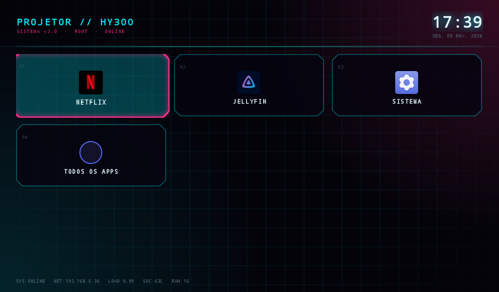
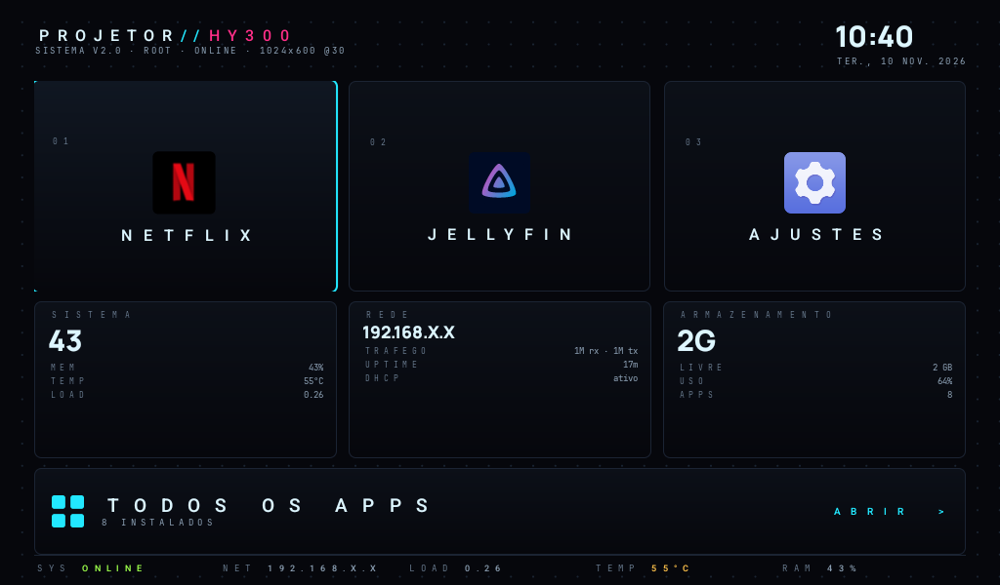
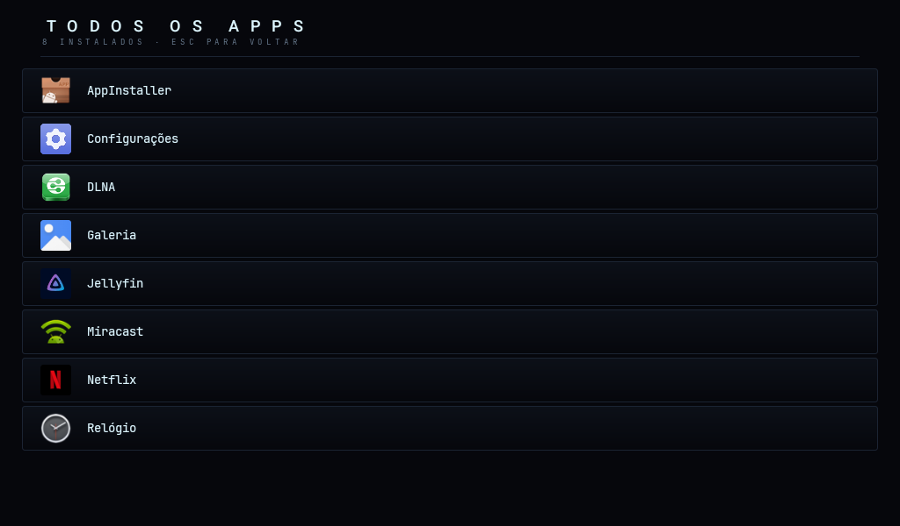

# HY300-T Cyber Launcher

Launcher Android TV com tema **cyberpunk**, escrito do zero (AAPT2 + javac + d8, sem AndroidX, sem anúncios, sem telemetria) para o projetor **HY300-T** (`t950s_be311`, Amlogic TXHD2, Android 13, `armv7`, 1 GB RAM, 1024x600).



## Recursos

- Grid neon com cantos chanfrados, borda ciano e glow magenta no item focado
- Navegação por D-pad; `Back` é bloqueado no home
- Relógio/data `pt-BR` com glow, índice `01..0N` por tile
- Barra de status ao vivo: `SYS:ONLINE`, IP, load average, temperatura do SoC
- Tiles somem sozinhos quando o app não está instalado (Netflix / Jellyfin / Globoplay)
- Tela "Todos os apps" com todos os pacotes que declaram `LAUNCHER`
- ~21 KB de APK no build v1, desenho estático (sem animação contínua) para não pesar em 1 GB de RAM

## Build

```bash
cd launcher          # v1 (cyberpunk)
./build.sh           # gera launcher.apk assinado com debug keystore

cd launcher/console  # v2 (console) - precisa de assets/fonts/ com Manrope-800.ttf e
./build.sh           # JetBrainsMono-Regular.ttf (nao versionadas: 300 KB de fonte)
```

Precisa de `aapt2`, `d8`, `apksigner`, `zipalign` (build-tools 36) e JDK. Os caminhos no script apontam para `~/Android/Sdk` — ajuste se necessário.

## Instalação

```bash
adb install -r dist/hy300-cyber-launcher.apk
adb shell cmd package set-home-activity br.dev.projetor.home/.HomeActivity
```

> Neste firmware o vendor resolve o home pela categoria não-padrão
> `android.intent.category.HOME.JM`. O manifest já declara `HOME`, `HOME.JM`,
> `DEFAULT` e `LAUNCHER`, senão o `FallbackHome` assume e a tecla HOME não volta.


## v2.0 — build "console" (2026-11-10)




APK: `dist/hy300-console-launcher-2.0.apk` — 168 KB, `versionName 2.0`, `versionCode 3`,
md5 `ac6ed3f0db9ecde9b86ee92532915fdd`. Desses 168 KB, só 27 KB são `classes.dex`; o resto
são as duas fontes embutidas (JetBrains Mono + Manrope 800). Continua sem AndroidX, sem
anúncio e sem telemetria.

- Layout nativo 1024x600 calibrado para densidade 140: header com relógio/data, três tiles
  de app, cards SISTEMA / REDE / ARMAZENAMENTO, tile largo "TODOS OS APPS" e faixa de status.
- Dados lidos do aparelho: RAM (ActivityManager), temperatura do SoC (thermal zones),
  load average e tráfego (`/proc`), armazenamento (StatFs), IP (ConnectivityManager).
- A lista "Todos os apps" colapsa rótulos repetidos — esta ROM tem dois apps de ajustes
  (`com.android.tv.settings` e `com.htc.htcsettings`) ambos chamados "Configurações"; fica
  o do vendor, que é onde estão os ajustes do projetor.
- O pacote mudou para `br.dev.projetor.console`. O antigo (`br.dev.projetor.home`) tinha
  sido instalado no overlay de `/system` com um keystore que não existe mais, então não dava
  para atualizar em cima; ele segue instalado, **desativado**, como rollback.

```bash
adb install -r dist/hy300-console-launcher-2.0.apk
adb shell cmd package set-home-activity br.dev.projetor.console/.HomeActivity
```

O build cyberpunk v1 continua em `dist/hy300-cyber-launcher.apk`.

## Firmware (específico deste projetor)

| Arquivo | Função |
|---|---|
| `firmware/tune.sh` | perfil de performance: `schedutil`, piso de 1 GHz, scheduler `none`, `read_ahead_kb=512`, `swappiness=100`, `dirty_ratio=10`, GPU fora do nível mínimo |
| `firmware/tune.rc` | serviço `init` que roda o `tune.sh` em `sys.boot_completed=1` |
| `firmware/preinstall.rc` | versão limpa do init do vendor, sem os serviços `ttyunos`, `preinstall`, `activation`, `shell_data`, `upgrade`, `update_apps`, `wifi_rftest` |

Contexto: o firmware original trazia `/system/bin/ttyunos.sh`, que baixava
`http://jm.ttyunos.com/install-recovery-curl.sh` e executava como **root** no boot.
Foi neutralizado (script e serviços removidos, domínio sem DNS).


Situação medida no aparelho em 2026-11-10: 96 pacotes instalados, **13 pacotes**
desinstalados para o usuário 0 e **10 APKs** apagados de `/system` pelo overlay, mais
**7 scripts** do vendor (entre eles o `ttyunos.sh`) — **23 pacotes de bloat** fora.
Load average ocioso: **0.28** (era 4.49 com o `ttyunos.sh` rodando em loop).

Aplicado no device via `adb remount` (overlayfs em `/system`), então a imagem base
continua intacta: o rollback é apagar `/data/gsi/remount/scratch.img` e
`/data/system/overlays.xml` e reiniciar.

## Aviso

O launcher é um APK comum. As partes de firmware mexem em `/system` via root/overlay
e são específicas desse modelo — **este aparelho não tem fastboot, recovery nem
burn-mode utilizável**, então faça dump das partições antes de qualquer coisa.

## Licença

MIT © 2026 Fabio Stella
